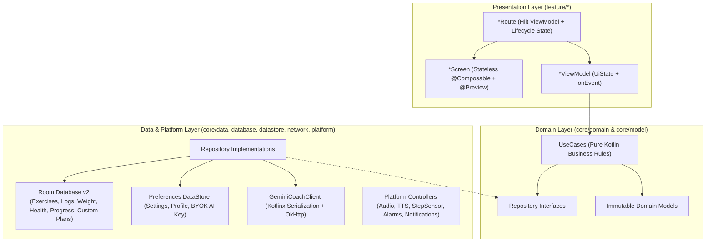

# Architecture Guide — FitFlow

FitFlow follows **Clean Architecture** combined with **Feature-First Modular Packaging** and **Unidirectional Data Flow (UDF)** on Jetpack Compose.

## Package Hierarchy (`io.github.vnquynh810.fitflow`)

- **`core/model`**: Pure Kotlin domain data classes (`Exercise`, `DayPlan`, `WorkoutExercise`, `UserProfile`, `DailyHealthMetrics`, `WorkoutLogEntry`, `SupplementaryWorkout`). Free of database or serialization framework coupling.
- **`core/domain`**:
  - `repository/`: Clean interfaces (`ExerciseRepository`, `WorkoutPlanRepository`, `ProgressRepository`, `HealthRepository`, `UserPreferencesRepository`, `AiCoachRepository`).
  - `usecase/`: Focused business logic units (`CalculateBmiUseCase`, `CalculateStreakUseCase`, `GenerateWorkoutPlanUseCase`, `CompleteWorkoutDayUseCase`).
- **`core/database`**: Room `AppDatabase`, entities, type converters (`kotlinx.serialization`), and reactive DAOs.
- **`core/datastore`**: Jetpack `DataStore<Preferences>` backed settings & profile persistence, including automatic one-time legacy `SharedPreferences` migration so upgrading users never lose progress.
- **`core/network`**: `GeminiCoachClient` supporting developer `BuildConfig.GEMINI_API_KEY` or user-supplied runtime **BYOK (Bring Your Own Key)** keys.
- **`core/platform`**: Lifecycle-safe wrappers around Android hardware and media services (`StepCounterTracker`, `WorkoutAudioController`, `TtsCoachController`, `WorkoutReminderScheduler`, `GifUrlProvider`, `NetworkMonitor`).
- **`core/designsystem`**: "Hyper Energy" Material 3 theme, typography (`Barlow`), color tokens, and reusable stateless UI components.
- **`feature/*`**: Self-contained vertical feature slices (`onboarding`, `dashboard`, `planner`, `session`, `library`, `profile`, `settings`, `coach`).
- **`navigation`**: Type-safe Kotlin Serialization route definitions (`AppRoutes.kt`) and centralized `FitFlowNavHost.kt`.
- **`di`**: Hilt dependency injection modules (`DatabaseModule`, `DataStoreModule`, `RepositoryModule`, `NetworkModule`).

## Key Design Decisions

1. **Zero Hardcoded Secrets (BYOK)**: Open-source clones compile out of the box without any secret file. Developers can set `GEMINI_API_KEY=...` in git-ignored `local.properties`, and end users can configure their own Gemini API key directly in **Settings -> AI Coach**.
2. **Hybrid Exercise Media Resolution**: `GifUrlProvider` automatically uses bundled offline assets (`file:///android_asset/gifs/...`) if downloaded via `scripts/download_gifs.ps1`, and transparently falls back to streaming + disk-caching from `https://github.com/wind5293/Exercise_GIFs/releases/latest/download/...` via Coil so the Git repository stays fast and lightweight.
3. **Synthesized CC0 Workout Beats**: Built-in background workout tracks are procedurally generated royalty-free audio loops (`CC0`), ensuring 100% legal redistribution for forks and F-Droid builds.
