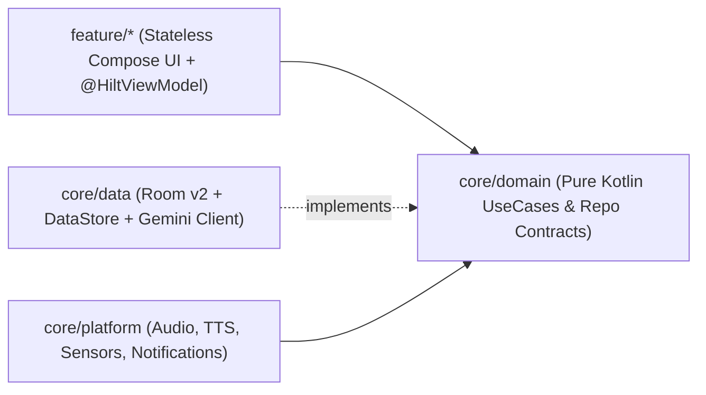

# FitFlow — Home Fitness Coach

[](https://github.com/VnQuynh810/fitflow/actions)
[](./LICENSE)
[](https://kotlinlang.org)
[](https://developer.android.com/jetpack/compose)
[](https://developer.android.com)

**FitFlow** is an open-source, native Android home fitness coach built with **Kotlin**, **Jetpack Compose**, and **Clean Architecture**. Designed around the high-contrast *Hyper Energy* theme, it guides users through structured 30-day workout protocols, real-time guided workout sessions with voice cues, hydration & step tracking, and an optional **Bring-Your-Own-Key (BYOK) Gemini AI Coach**.

---

## Highlights & Features

- **Physical Calibration & Smart Onboarding**: Interactive height/weight pickers, live BMI classification, goal calibration (*Weight Loss*, *Muscle Gain*, *Endurance*, *Maintenance*), and daily workout reminders.
- **Structured 30-Day Training Protocols**: Goal-specific plans with customizable daily routines (drag-and-drop reordering, exercise swapping, and rep/duration tuning).
- **Guided Interactive Workout Sessions**: 3-phase session state machine (`PREPARING` -> `EXERCISING` -> `RESTING`) with animated exercise demonstrations, Text-to-Speech voice coaching, and built-in **CC0 synthesized workout loops**.
- **Push Your Limits & Exercise Library**: 5 targeted HIIT/strength bonus sessions plus a searchable, filterable catalog of 1,200+ exercises with muscle tags and form instructions.
- **Health, Hydration & Streak Analytics**: Hardware step-counter integration (`TYPE_STEP_COUNTER` / `TYPE_STEP_DETECTOR`), interactive foreground hydration notification, weekly duration/calorie bar charts, and weight trend tracking.
- **FitBro AI Coach (BYOK)**: Multimodal fitness & food-photo nutrition assistant powered by Google Gemini (`gemini-2.5-flash`). Works out of the box with zero hardcoded keys — users can configure their own free API key directly in Settings.

---

## Clean Architecture Overview

FitFlow is structured using **Clean Architecture + Feature-First UDF (Unidirectional Data Flow)** so contributors can navigate, test, and extend features independently:



```text
app/src/main/java/io/github/vnquynh810/fitflow/
├── core/
│   ├── model/          # Pure Kotlin domain models
│   ├── domain/         # Repository interfaces & pure Kotlin UseCases
│   ├── database/       # Room v2 database, entities & reactive DAOs
│   ├── datastore/      # Jetpack Preferences DataStore + legacy migrator
│   ├── data/           # Repository implementations
│   ├── network/        # Kotlinx Serialization + OkHttp Gemini client
│   ├── platform/       # Audio, TTS, Step Sensor, Alarms, Hybrid GIF resolver
│   └── designsystem/   # Hyper Energy theme, Barlow typography & shared UI
├── feature/            # Vertical feature slices:
│   ├── onboarding/     ├── dashboard/      ├── planner/        ├── session/
│   ├── library/        ├── profile/        ├── settings/       └── coach/
├── navigation/         # Type-safe @Serializable Navigation Compose graph
└── di/                 # Hilt dependency injection modules
```

See [ARCHITECTURE.md](./ARCHITECTURE.md) for a deep dive into data flow and module responsibilities.

---

## Quick Start (Build in < 3 Minutes)

1. **Clone the repository**:
   ```bash
   git clone https://github.com/VnQuynh810/fitflow.git
   cd fitflow
   ```

2. **Build & Run** (JDK 17 + Android SDK 35):
   ```bash
   ./gradlew testDebugUnitTest assembleDebug
   ```
   > **No API keys required to build!** Exercise GIFs stream automatically from the [`wind5293/Exercise_GIFs`](https://github.com/wind5293/Exercise_GIFs) release CDN and cache locally via Coil.

3. **Optional — Configure Gemini AI Coach**:
   - **In-App (Recommended)**: Open **Workout Settings -> AI Coach API Key** and paste a free key from [Google AI Studio](https://aistudio.google.com/apikey).
   - **Developer `local.properties`**: Add `GEMINI_API_KEY=your_key_here` to `local.properties` (git-ignored).

4. **Optional — Bundle Exercise GIFs Offline**:
   ```powershell
   pwsh ./scripts/download_gifs.ps1
   ```
   When present in `app/src/main/assets/gifs/`, `GifUrlProvider` automatically serves local assets with zero network usage.

---

## Hướng Dẫn Nhanh (Tiếng Việt)

- **Kiến trúc**: Ứng dụng đã được chuẩn hoá theo **Clean Architecture + Feature-First MVVM (UDF)** với **Hilt DI**, **Room Database v2**, **Jetpack DataStore**, và **Type-Safe Navigation Compose**.
- **Bảo mật API Key (BYOK)**: Không lưu bất kỳ khoá bí mật nào trong mã nguồn. Bạn có thể tự nhập `Gemini API Key` trực tiếp trong phần **Cài đặt (Workout Settings)** của ứng dụng hoặc khai báo `GEMINI_API_KEY=...` trong `local.properties`.
- **Tài nguyên nhẹ & Sạch bản quyền**: Nhạc nền tập luyện tích hợp sẵn thuộc phạm vi công cộng (**CC0**), và bộ ảnh động bài tập hỗ trợ vừa tải tự động qua CDN + Coil Disk Cache vừa hỗ trợ tải offline qua `scripts/download_gifs.ps1`.

---

## Contributing & License

Contributions, issues, and feature requests are welcome! Please read [CONTRIBUTING.md](./CONTRIBUTING.md) and our [Code of Conduct](./CODE_OF_CONDUCT.md) before submitting a Pull Request.

Distributed under the **MIT License**. See [LICENSE](./LICENSE) for full text.
